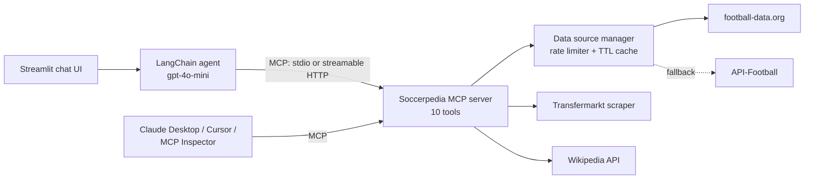

# Soccerpedia

[](https://github.com/RobertRotaru/SoccerPedia/actions/workflows/ci.yml)

A football (soccer) assistant built as an **LLM agent + MCP server**. Ask it about results, fixtures,
standings, player careers or transfers and it answers from live data sources rather than from the
model's memory.

The data layer is a standalone **Model Context Protocol server**, so the same tools work in the
Soccerpedia chat UI, in Claude Desktop, in Cursor, or in any other MCP client.

## Architecture



Match and standings data come from the football APIs. Player, career and transfer data come from
Transfermarkt and Wikipedia.

| Component | Path | What it does |
|---|---|---|
| MCP server | `soccerpedia/mcp_server/football_mcp.py` | Publishes the tool layer over MCP (stdio or streamable HTTP). Tool schemas are generated from the Python signatures and docstrings. |
| Agent | `soccerpedia/agent/agent_factory.py` | LangChain 1.x `create_agent`. Discovers its tools **from the MCP server** through `langchain-mcp-adapters` and never imports them directly. |
| Tools | `soccerpedia/agent/tools.py` | 10 tools: current date, latest results, standings, upcoming fixtures, live matches, player career stats, player comparison, transfer news, multi-club careers, free-text search |
| Data sources | `soccerpedia/agent/data_sources.py` | For matches and standings, tries football-data.org first and falls back to API-Football. Each source has its own rate limiter (at least 1 s between requests, at most 10 per minute) and retries on timeouts and server errors. Transfermarkt pages and the Wikipedia API are scraped for player data. |
| Cache | `soccerpedia/agent/cache_manager.py` | Two-level TTL cache: in memory, backed by JSON files so entries survive a restart. Used for live matches (30 s) and upcoming fixtures (3 min). The latest-results and standings tools skip it on purpose so they always return fresh data. Responses that contain an error are never cached. |
| UI | `soccerpedia/gui/app.py` | Streamlit chat. Conversations are saved to a local JSON file and can be reopened. |

### Design notes

- **Why MCP instead of in-process tools?** It decouples the data layer from the agent. The tools
  can be reused by other clients, tested on their own, and run as a separate service. The agent
  only knows the server's address.
- **Two transports.** stdio needs no setup because the agent spawns the server. Streamable HTTP
  keeps a single long-lived server, which avoids starting a new process for every tool call and
  suits a deployment where the UI and the server run separately.
- **Stdout safety.** With stdio, stdout *is* the JSON-RPC channel, so the server sends any stray
  `print()` from the data sources to stderr.
- **Rate limits.** The football-data.org free tier allows 10 requests a minute. When a source hits
  that limit, the limiter waits for the next minute instead of letting the request fail.
- **Bounded agent loop.** The agent stops after 16 graph steps (about 8 tool calls), so a confused
  model cannot loop on tools forever.

## Quick start

```bash
git clone https://github.com/RobertRotaru/SoccerPedia.git
cd SoccerPedia/soccerpedia
python -m venv .venv && source .venv/bin/activate   # Windows: .venv\Scripts\activate
pip install -r requirements.txt
cp .env.example .env    # then add your keys
```

| Variable | Required | Where to get it |
|---|---|---|
| `OPENAI_API_KEY` | yes | https://platform.openai.com/api-keys |
| `FOOTBALL_DATA_API_KEY` | yes | free at https://www.football-data.org/client/register |
| `API_FOOTBALL_KEY` | optional | https://www.api-football.com/ |

Run it:

```bash
./run.sh                    # MCP server on :8000 (HTTP) + Streamlit UI
# or just the UI; it spawns the MCP server over stdio:
streamlit run gui/app.py
```

### Use the tools from Claude Desktop (or any MCP client)

```json
{
  "mcpServers": {
    "soccerpedia": {
      "command": "/path/to/SoccerPedia/soccerpedia/.venv/bin/python",
      "args": ["-m", "mcp_server.football_mcp"],
      "cwd": "/path/to/SoccerPedia/soccerpedia"
    }
  }
}
```

Or explore it interactively: `npx @modelcontextprotocol/inspector python -m mcp_server.football_mcp`

## Example questions

- What were the latest La Liga results?
- Show me the current Premier League table.
- What Champions League matches are on this week?
- Compare Mbappé and Haaland.
- What is Mbappé's transfer history?

League codes: `PL` Premier League · `PD` La Liga · `BL1` Bundesliga · `SA` Serie A · `FL1` Ligue 1 · `CL` Champions League · `EL` Europa League · `WC` World Cup

## Known limitations

- **No conversation memory.** The UI saves your chats, but each message goes to the agent on its
  own, so a follow-up like "and their next match?" does not know what "their" refers to.
- **Transfer news is player-level only.** Asking about a player scrapes their Transfermarkt page.
  Club-level and general transfer news return a placeholder, not real data.
- **Multi-club questions are approximate.** "Players who played for Arsenal and Barcelona" runs
  Transfermarkt and Wikipedia searches. It does not cross-check the two clubs' squad histories, so
  the answer depends on what those searches return.
- **Current-season stats are hard-coded.** The API-Football lookup for current-season stats uses
  the 2024 season and the Premier League, and only runs if `API_FOOTBALL_KEY` is set.
- **Latest results can be slow.** The tool checks one day at a time, up to three weeks back, with
  a fresh request each day. On the free tier that can reach the rate limit and wait for a minute.
- **Scrapers are fragile.** Transfermarkt parsing depends on the site's HTML and breaks if the
  layout changes.

## Tests

```bash
pip install -r requirements-dev.txt
pytest
```

The 9 tests cover the cache (TTL, persistence, error handling) and the MCP server (tool
registration, generated schemas, calls). It also has an end-to-end test where the agent spawns
the real MCP server over stdio, discovers its tools and runs one. A fake LLM stands in for the
model, so the tests need no API keys and run in CI on every push.

## License

MIT
